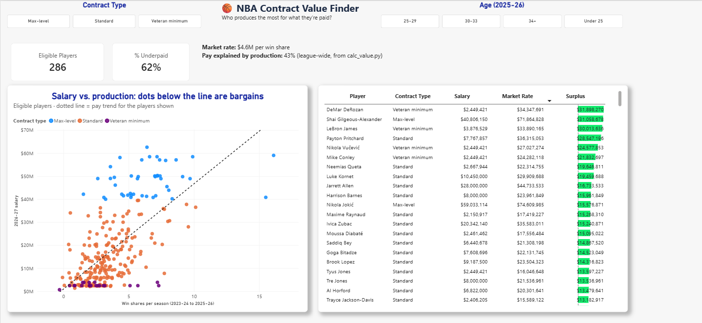
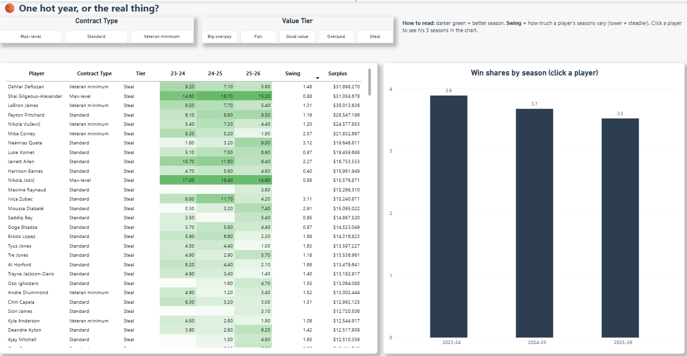

# NBA Contract Value Finder

Which NBA players produce the most for what they're paid, and is it a pattern or one hot year?

This is a pay-for-performance analysis: the same method a compensation team uses to check whether pay lines up with results, applied to real NBA salaries and stats.

## Dashboard





## The question

- Fit a "market pay line": what the league pays, on average, for a given level of production.
- Compare every player's actual 2026-27 salary to what that line says he should earn.
- The difference is **surplus value**. Positive means a bargain; negative means overpaid.
- Check whether the production behind it held up across all three seasons.

## Data

Real data, downloaded by hand from [Basketball-Reference](https://www.basketball-reference.com):

| File | What it holds |
| --- | --- |
| `advanced_2024`, `advanced_2025`, `advanced_2026` | Player advanced stats for 2023-24, 2024-25 and 2025-26 (Basketball-Reference names a season by the year it ends) |
| `per_game_2026` | Points, rebounds and assists per game for 2025-26 |
| `contracts` | Salaries for 2026-27 and beyond |
| `draft_2023`, `draft_2024`, `draft_2025` | First-round picks, used to exclude rookie-scale contracts |

## How it works

**Step 1: `clean_data.py`** makes the exports usable:
- finds the real header row and drops "League Average" rows
- keeps the combined season row for traded players (2TM, 3TM) and drops the partial per-team rows (480 removed)
- turns salary text like `$62587158` into numbers
- removes 8 duplicate contract rows from waived money, keeping the larger guaranteed row and logging each one
- joins stats and contracts on Basketball-Reference's player ID
- matches draft picks by name, because the draft tables have no player ID. A safety rule prevents false matches: a player can't have played before his draft year. 89 of 90 first-round picks matched; the one miss never played.
- runs checks and writes `data/clean/cleaning_log.txt`

**Step 2: `calc_value.py`** does the analysis:
- **Production** = Win Shares per season, averaged over the seasons a player played.
- **Eligible** = 1,500+ total minutes, a 2026-27 salary, and not on a rookie-scale deal (2023-25 first-round picks). That leaves **286 players**.
- **Market pay line**, fit by least squares: salary = $0.9M + **$4.58M per win share**. Production explains **43%** of pay (R-squared 0.43).
- **Surplus value** = market rate − actual salary, grouped into tiers: Steal 51, Good value 99, Fair 42, Overpaid 38, Big overpay 56.
- Context columns: contract type (Standard, Veteran minimum, Max-level) and age band.
- Writes `data/clean/player_value.csv` and `value_log.txt`.

**Step 3: Power BI** (`dashboards/nba_value_dashboard.pbix`):
- **Value Map:** salary vs. production scatter with the pay line, a ranked surplus table, and slicers for contract type and age.
- **Consistency:** each player's three seasons side by side, plus a "swing" score (standard deviation of win shares; lower = steadier). Click a player to see his seasons charted. The season data is reshaped with a Power Query unpivot.

## Findings

**1. Most "steals" and "overpays" come from contract structure, not bad decisions.**

| Contract type | Average surplus |
| --- | --- |
| Standard | +$2.5M (close to fair, as a working market should be) |
| Veteran minimum | +$10.6M (cheap because teams expect decline) |
| Max-level | −$17.7M (stars are paid for future value and name) |

**2. The real steals are on standard contracts.** Led by Payton Pritchard (+$28.5M), then Neemias Queta, Luke Kornet, Jarrett Allen, Harrison Barnes, Maxime Raynaud and Ivica Zubac.

**3. Consistency separates the real thing from one hot year.**
- Nikola Jokić: 17.0 / 16.4 / 14.9 win shares. Elite and steady.
- Payton Pritchard: 6.1 / 8.6 / 8.5. A steady value, not a fluke.
- Neemias Queta: 1.8 / 3.2 / 9.0. One big jump, so the value is real but less proven.
- The average eligible player slid from 3.9 to 3.7 to 3.5 win shares, which makes players who held steady stand out more.

**4. 62% of eligible players are paid below the market rate**, mostly because a few very large contracts pull the line up.

## Limits

- **The model looks backward; teams pay forward.** Salary reflects expected future value, especially for young players.
- **The max salary is capped,** so superstars (Shai Gilgeous-Alexander) look like "steals" partly because they can't be paid what they produce.
- **Injuries drag the overpaid list** (Embiid, Morant): missed games lower a counting stat like Win Shares.
- **Win Shares leans toward centers.** A good next check is the same analysis with VORP, which is already saved as `vorp_per_season`.
- **A straight line struggles at the edges** (minimum and max contracts). Contract type is shown alongside for that reason.

## How to run

Requires Python 3. No packages needed.

1. Download the eight tables from Basketball-Reference ("Share & Export → Get table as CSV") into `data/raw` with the file names above.
2. Run:
   ```
   python clean_data.py
   python calc_value.py
   ```
3. Open `dashboards/nba_value_dashboard.pbix` in Power BI Desktop and click **Refresh**.

## Tech

Python (standard library) · least-squares regression · data cleaning and record matching · Power BI (DAX measure, Power Query unpivot, conditional formatting)

*Data: [Basketball-Reference.com](https://www.basketball-reference.com). This is an independent analysis, not affiliated with the NBA or any team.*
